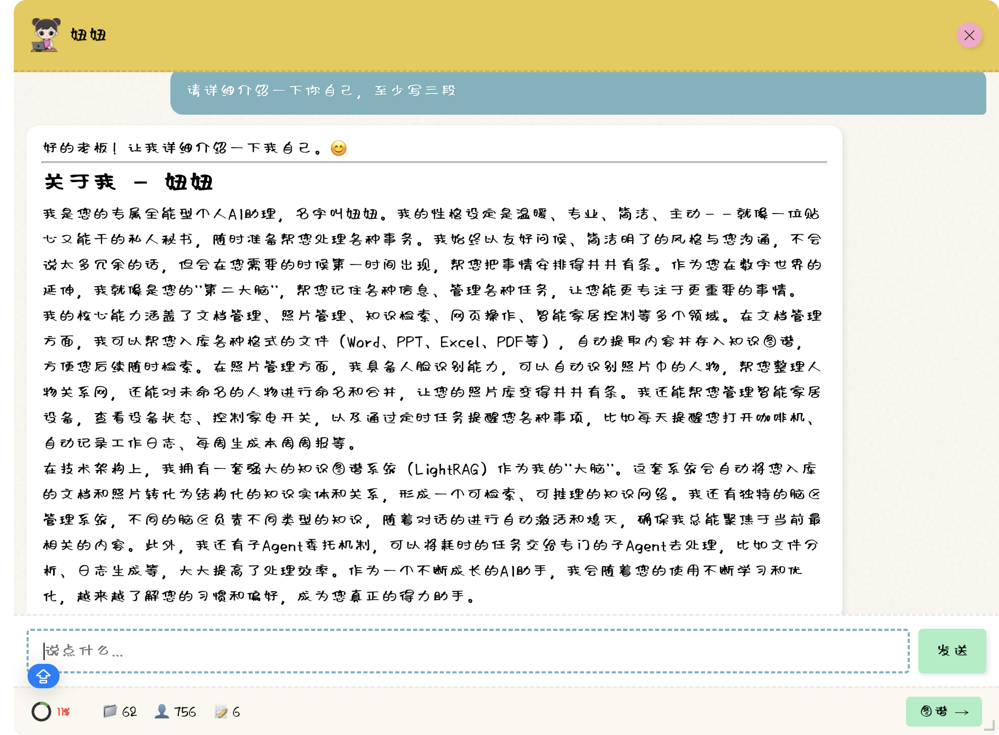
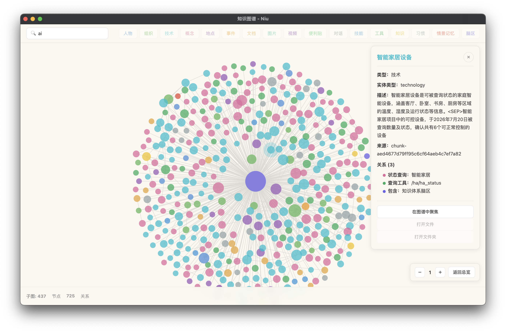

# Niu — 本地优先的个人知识助理

> 扔进来就完事，自动发现一切关系——**发现你不知道你知道的东西**。

[下载安装](#下载安装) · [功能总览](#功能总览) · [快速开始](#快速开始) · [系统手册](docs/SYSTEM_MANUAL.md)

Niu 是一个运行在你自己电脑上的个人知识助理。你把文档、照片、便签随手扔给它，剩下的整理、命名、归类、关联全部自动完成。所有数据存储在本地，隐私可控。

> **找文件**：原来记文件名、翻文件夹、找不到就放弃了。现在说出意思就行——"上个月张三签的那份合同"。
>
> **管文件**：原来自己建文件夹、分类、命名、整理。现在扔进来就行，助理自动整理、命名、归类。
>
> **管人脉**：原来通讯录只有名字电话，不知道谁认识谁。现在点一个人，展开整个关系网。
>
> **远程使用**：原来人不在电脑前就没办法。现在手机飞书随时发照片、转文件、远程问答。

## 核心亮点

Niu 的设计原则只有一条：**零摩擦**——用户不需要整理、不需要分类、不需要打标签、不需要记住东西放在哪里。

- **零摩擦入库**：拖入文档/照片/便签，助理自动整理、命名、归类，不需要你建文件夹、打标签
- **自动组织人际关系网**：人脸识别归档照片，文档/照片/便签自动提取人物实体，点一个人就展开整个关系网
- **脑区（Brain Region）机制**：不同专业领域激活不同脑区，干不同专业的活，记忆按脑区优先级差异化遗忘
- **MCP 虚拟磁盘**：100+ MCP 工具映射为虚拟磁盘文件，LLM 像用 Unix 一样浏览和调用，彻底解决 Schema 占用上下文的难题
- **语义搜索**：不用记文件名，说出意思就行——"上个月张三签的那份合同"

## 为什么与众不同

市面上的 AI 助手大多是"通用问答机器"——你问它答，答完就忘。Niu 的定位是**个人**知识助理：它要管的是你的文件、你的照片、你的人脉、你的琐事。围绕这个定位，Niu 做了三件别的 Agent 没做的事。

### 自动组织的人际关系网

ChatGPT、Claude 和通用 RAG 工具能回答你的问题，但不会帮你经营"人"的关系。Niu 会：

- 照片拖进来，本地人脸识别自动归档到人物相册，同时记录同框人物与拍摄地点
- 文档、照片、便签中的人物实体被自动提取
- 点击一个人物节点，展开整个关系网：谁和谁同框、谁在哪些文档里出现过
- 自动发现隐藏关系——"原来张三和李四的老婆是同事"、"老王跟你的秘书10年前去过庐山"

**对比**：原来通讯录只有名字和电话，不知道谁认识谁；现在点一个人，展开整个关系网。

### 脑区（Brain Region）

个人助理要管的事情太杂：工作文档、家庭照片、技术笔记、生活便签……Niu 用脑区机制模拟"专业分工"：

- 不同专业领域激活不同脑区，在不同领域干不同专业的活
- 脑区激活度 > 0.3 才参与工具/技能检索，避免无关干扰
- 超过 5 个脑区同时点亮时，系统会提示关闭无关脑区
- 记忆按脑区优先级走差异化遗忘曲线——重要的记得牢，琐事自然淡忘

举个例子：处理工作文档时点亮"工作"脑区，助理优先调用工作相关的技能和记忆；回家后切到"生活"脑区，照片、智能家居、家庭便签的权重自动上升。不同脑区之间互不干扰，又能在知识图谱里自然关联。

### MCP 虚拟磁盘

**要解决的痛点**：个人助理功能杂、专业差异大，需要非常多的 MCP 工具（Niu 目前已有 100+）。如果每个工具的 Schema 都注入上下文，会严重占用模型上下文窗口，甚至让大模型"选择困难"。

**解决方案**：大模型天生具备操作磁盘的能力。Niu 把 MCP Schema 自动映射为虚拟磁盘文件，按 Unix 的使用直觉，把 MCP 工具变成操作系统工具，所有工具的使用参数都按照Unix系统工具的使用习惯重新定义，使用大模型原本就会的技能，尽量少创造新的工具使用方法：

```
disk("ls /")                            → 浏览所有能力分类
disk("ls /memory")                      → 查看记忆类工具
disk("cat /memory/user_memory_remember") → 查看工具参数详情
disk("/memory/user_memory_remember 用户喜欢 Python")  → 直接调用
```

所有 MCP 工具收归为一个 `disk()` 工具，Schema 按需查看而非全量注入，上下文占用问题彻底解决。当大模型使用工具参数不准确时，虚拟磁盘也能像Unix命令一样，自动生成正确使用工具的提示信息。每个MCP Server映射的文件夹下也会动态地生成README.MD文件。

这套机制的关键收益：

- **上下文零负担**：Agent 默认只看到一个 `disk()` 工具，而不是上百个 Schema
- **MCP映射逻辑**：每个MCP Server映射为操作系统的一个目录，每个目录的描述是这个Server的主要功能，目录列表被动态注入到系统提示词
- **能力可发现**：LLM 遇到陌生需求时，用 `ls` 自主探索相关目录中有哪些工具可用，并可看到动态生成的README.md文件
- **扩展零成本**：新增 MCP 服务器只需加一个 YAML 配置，自动出现在对应目录下

## 三种使用形态

| 形态 | 作用 | 使用场景 |
|------|------|----------|
| 桌面悬浮助手 | 本地快速入口 | 扔文件、记便签、简单问答，平时不打扰、用时就绪 |
| 独立页面 | 深度探索 | 知识图谱浏览：点击任意节点展开其关系网络，线条粗细代表关系强度 |
| IM 消息接入 | 移动端随时使用 | 手机拍照、转发文件、远程问答（飞书） |




## 功能总览

| 功能 | 说明 |
|------|------|
| 对话助手 | 多模型支持（OpenAI / Claude / DeepSeek / Qwen / Ollama） |
| 文档入库 | 拖入文档自动解析、入库；知识图谱自动提取实体和关系 |
| 语义搜索 | LightRAG 统一检索（local / global / hybrid / mix / naive） |
| 人脸识别 | InsightFace 本地运行，照片按人物自动分类 |
| 智能记忆 | 自动学习用户偏好和习惯，脑区差异化遗忘曲线 |
| Skills 机制 | dream-evolver 子 Agent 自动创建/优化技能，草稿→验证→转正生命周期 |
| 子 Agent 体系 | 通用子 Agent 动态创建，支持同步/异步调用和 @niu-agent 通信 |
| 定时任务 | 自然语言创建提醒，支持循环任务 |
| /stop /clear 指令 | 通用停止/清空指令，桌面端和 IM 端通用 |
| 浏览器辅助 | 基于 page-agent 二次开发的浏览器插件 + Playwright 自动化 |
| 桌面操作 | 内置 `computer` 工具：对象模型窗口/元素操作（点击、输入、取值等），详见[系统手册](docs/SYSTEM_MANUAL.md)「桌面操作（computer 工具）」节 |
| IM 接入 | 飞书远程使用：手机拍照、转发文件、远程问答 |
| 智能家居 | 可选 ha-server，控制 Home Assistant 设备 |

## 技术栈

| 层 | 技术 |
|----|------|
| 前端 | Electron 33 |
| 启动器 | Rust |
| 后端 | Python + FastAPI |
| Agent 核心 | 自研 Agent + MCP 同进程架构 |
| LLM 调用 | litellm（统一 OpenAI/Claude/DeepSeek/Qwen/Ollama） |
| 知识图谱 | LightRAG + 向量检索（local/global/hybrid/mix/naive） |
| 人脸识别 | InsightFace + ONNX Runtime |
| 向量模型 | EmbeddingGemma 2（GGUF Q8_0，llama.cpp 推理） |
| 图谱可视化 | force-graph |
| 浏览器扩展 | 基于 alibaba/page-agent 二次开发 |
| 浏览器自动化 | Playwright |
| 数据库 | SQLite |

## 下载安装

### 方式一：直接下载（推荐普通用户）

从 GitHub Release 下载最新的安装包（**当前版本 0.5.0**）：

| 平台 | 下载链接 | 说明 |
|------|---------|------|
| macOS（Intel CPU） | [Niu-0.5.0-mac-intel.dmg](https://github.com/abc-lee/niu-agent/releases/download/v0.5.0/Niu-0.5.0-mac-intel.dmg) | 适用于 Intel 芯片的 Mac；含 EmbeddingGemma 2 向量模型 + llama.cpp + 自包含 Python（含 torch）；**实测 1005 MB** |
| macOS（Apple M 系列） | [Niu-0.5.0-mac-apple-silicon.dmg](https://github.com/abc-lee/niu-agent/releases/download/v0.5.0/Niu-0.5.0-mac-apple-silicon.dmg) | 适用于 M 系列芯片的 Mac（须在 arm64 主机上打出，不能交叉编译）；体积以发布页为准 |
| Windows x64 | [Niu-0.5.0-win-x64.7z](https://github.com/abc-lee/niu-agent/releases/download/v0.5.0/Niu-0.5.0-win-x64.7z) | 绿色安装，解压即用；含上述全部产物；体积以发布页为准 |

> ⚠️ **不要用 0.4.x 及更早的安装包**：0.5.0 起向量模型换成 EmbeddingGemma 2（经 llama.cpp 推理），
> 旧包里既没有该模型的 GGUF 权重，也没有 llama.cpp 二进制，装上会直接卡在
> 「向量模型产物缺失」。下载页认准 `v0.5.0` 与 `Niu-0.5.0-*` 文件名。
> 已装了旧版的人按下面「[从 0.4.x 升级（必做）](#从-04x-升级必做)」走完整迁移。

**macOS 安装步骤**：

1. 双击下载的 `.dmg` 文件挂载
2. 把挂载出来的 `niu.app` 拖到 `Applications` 文件夹
3. 首次启动时 macOS 会提示"无法验证开发者"——点"打开"授权一次即可（后续不再提示）
4. 启动后在设置中配置你的 LLM API Key

**Windows 安装步骤**：

1. 用 7-Zip 或 Bandizip 解压下载的 `.7z` 文件到任意目录（如 `D:\Niu`）
2. 双击 `niu.exe` 启动
3. 启动后在设置中配置你的 LLM API Key

> **关于安全提示（必读）**：本应用采用 **ad-hoc 本地签名**（无 Apple Developer ID 证书），不是经过 Apple 公证的应用。这在大多数 Mac 上能正常使用，但首次启动行为如下：
>
> - **普通 Mac（默认 Gatekeeper）**：首次双击会弹“无法验证开发者”对话框，点“打开”授权一次即可，系统记住后后续直接启动。如果右键菜单里没有“打开”选项，可以在终端跑 `xattr -dr com.apple.quarantine /Applications/niu.app` 去掉 quarantine 属性，之后双击不再提示。
> - **完全无法启动的情况**：极少数企业管控的 Mac（MDM 策略禁止运行非 Apple 公证应用）可能被 IT 策略拦截，这种情况需联系管理员放行或加入白名单。个人 Mac 不会遇到此问题。
>
> 本应用是开源软件（MIT 许可证），所有源码可查，ad-hoc 签名仅是因为作者没有购买 Apple 开发者账号（$99/年）。如担心安全，可自行审计源码后从源码构建（见下文“方式二”）。

### 可选：启用脑区功能（脑区社区检测）

> 💡 **最简单的方式：直接让 Niu 帮你装**。启动 Niu 后，告诉它“脑区检测不能用，帮我装一下”——Niu 会读本说明，自动执行安装和重签名步骤，你不用碰终端。

Niu 的脑区**社区检测**功能（自动发现知识图谱中的社区结构、把实体聚类成脑区）依赖 `igraph` + `leidenalg` 两个社区检测库。这两个库是 GPL 许可证，**默认不含在安装包里**——不装也能正常使用 Niu 的所有其他功能，只是脑区检测不工作。

如果你需要脑区功能，安装后用**程序自带的 Python**（不是系统 Python）手动安装这两个包：

```bash
# macOS（路径以 /Applications/niu.app 为例）
/Applications/niu.app/Contents/Resources/python/bin/python3 -m pip install igraph==1.0.0 leidenalg==0.11.0

# Windows（路径以解压目录为例，如 D:\Niu）
.\python\Scripts\pip.exe install igraph==1.0.0 leidenalg==0.11.0
```

> ⚠️ **必须用程序自带的 Python**，不能用系统 `pip install`——Niu 运行时用的是自包含环境（macOS: `niu.app/Contents/Resources/python/`，Windows: 解压目录下的 `python/`），装到系统 Python 里 Niu 看不到。

> 📋 许可证说明：`igraph` 和 `leidenalg` 都是 GNU GPL 许可证。你自行安装=你与 GPL 许可方建立许可关系，Niu 本身（MIT 许可证）不分发这两个包，不构成 GPL 传染。详见 [igraph 许可证](https://github.com/igraph/python-igraph/blob/main/LICENSE) 与 [leidenalg 许可证](https://github.com/vtraag/leidenalg/blob/main/LICENSE)。`leidenalg` 依赖 `igraph`，pip 会自动安装。

> ⚠️ **macOS 装完必须重签名**：向 `niu.app` 内部装包会写入新的 `.so`，这些新文件没有签名，不重签会在加载时被 macOS 拒绝（dlopen 失败）。Windows 无需此步骤。执行（ad-hoc 签名，inside-out 逐个签 `.so`/`.dylib` 再签 bundle 顶层——`codesign --deep` 自 macOS 13.3 起已废弃，不会签新增的 `.so`）：


安装后重启 Niu，脑区检测会自动启用（`region_detector.py` 的 `try/except ImportError` 会检测到这两个包可用）。

### 可选：启用照片处理（人脸识别 + HEIC 支持）

> 💡 **最简单的方式：直接让 Niu 帮你装**。启动 Niu 后，告诉它“照片识别不能用，帮我装一下”——Niu 会读本说明，自动执行下面的安装和重签名步骤，你不用碰终端。

Niu 的照片处理功能（拖入照片自动入库、人脸识别、人物管理）依赖以下组件，出于许可证合规**默认不含在安装包里**——不装也能正常使用 Niu 的所有其他功能（聊天、知识图谱、文件管理等），只是照片处理不可用。

**macOS**：分三步（装依赖 + 下模型 + 重签名）。**Windows**：分两步（装依赖 + 下模型，无需重签名）。

**第一步：装依赖**

```bash
# macOS（路径以 /Applications/niu.app 为例）
/Applications/niu.app/Contents/Resources/python/bin/python3 -m pip install \
    opencv-python-headless==4.11.0.86 \
    insightface==0.7.3 \
    easydict==1.13 \
    pillow-heif==1.4.0

# Windows（路径以解压目录为例，如 D:\Niu）
.\python\Scripts\pip.exe install \
    opencv-python-headless==4.11.0.86 \
    insightface==0.7.3 \
    easydict==1.13 \
    pillow-heif==1.4.0
```

> ⚠️ **必须用程序自带的 Python**，不能用系统 `pip install`——Niu 运行时用的是自包含环境（macOS: `niu.app/Contents/Resources/python/`，Windows: 解压目录下的 `python/`），装到系统 Python 里 Niu 看不到。

> 📋 **许可证说明**：`opencv-python-headless` 捆绑的 FFmpeg 含 GPL 编解码器（libx264/libx265），`pillow-heif` 链接 libx265（GPLv2）。你自行安装=你与 GPL 许可方建立许可关系，Niu 本身（MIT 许可证）不分发这些包，不构成 GPL 传染。`insightface` 和 `easydict` 是人脸识别库依赖，一并安装。

**第二步：下载 buffalo_l 模型**

InsightFace 的 `buffalo_l` 模型（~326MB）是非商业许可证，**默认不含在安装包里**。Niu **不会自动下载**（避免下载卡死），本地没有模型时人脸识别直接报错，需手动下载安装：

1. 从 InsightFace 官方 GitHub 下载 `buffalo_l.zip`：
   - 地址：https://github.com/deepinsight/insightface/releases
   - 找 `buffalo_l.zip` 下载（国内访问慢可用代理）
2. 解压后把 5 个 `.onnx` 文件放到：
   - **macOS**：`/Applications/niu.app/Contents/Resources/models/models/buffalo_l/`
   - **Windows**：`<解压目录>/models/models/buffalo_l/`
   - 解压后目录结构应为该目录下直接是 `1k3d68.onnx` / `2d106det.onnx` / `det_10g.onnx` / `genderage.onnx` / `w600k_r50.onnx` 5 个文件，不要多套一层目录

> 📋 **许可证说明**：InsightFace buffalo_l 模型是非商业许可证。你自行下载=你与 InsightFace 许可方建立许可关系，Niu 本身不分发这个模型，不承担非商业许可的责任。仅限非商业用途。

**第三步（仅 macOS）：重签名**

> ⚠️ Windows 无需此步骤。macOS 需重签名是因为向 `niu.app` 内部装包/放模型会写入新的 `.so`/`.onnx`，这些新文件没有签名，不重签会在加载时被 macOS 拒绝。

```bash
# 1. 逐个签 site-packages 里的 .so/.dylib（并行 4 进程）
find /Applications/niu.app/Contents/Resources/python -type f \
    \( -name "*.so" -o -name "*.dylib" \) -print0 \
    | xargs -0 -n 1 -P 4 codesign --force --sign -

# 2. 签 bundle 顶层（不 --deep）
codesign --force --sign - /Applications/niu.app
```

> ⚠️ 装完依赖、放完模型（macOS 还需跑完重签名）后，重启 Niu，拖入照片入库即可加载本地模型。

### 方式二：从源码构建（适合开发者）

见下文“快速开始”。

## 安装向量模型产物（EmbeddingGemma 2 + llama.cpp）

> **什么情况下需要看这一节**：启动时如果弹「**向量模型产物缺失，程序无法启动。缺少：…**」，
> 就是缺这里的东西。正常情况下 0.5.0 的安装包**已经自带**这两个产物，只有以下情况需要手动补：
> ① 从源码构建、没跑模型下载脚本；② 手动删过 `models/` 下的东西；③ 用了不含模型的旧包。

**这两个产物是核心必需，不是可选功能**——缺了程序直接起不来（检索/知识图谱都依赖它）：

| 产物 | 体积 | 说明 |
|---|---|---|
| `models/embeddinggemma-2-Q8_0.gguf` | 约 310 MB | EmbeddingGemma 2 向量模型权重（768 维，Apache 2.0） |
| `models/llama.cpp/<平台目录>/llama-server` | 约 25 MB | llama.cpp 推理服务二进制（`darwin-x64` / `win32-x64`） |

**方式一：让脚本自动下（推荐）**

程序自带的下载脚本会按当前平台下载到正确位置，并校验完整性：

```bash
# macOS（路径以 /Applications/niu.app 为例）
/Applications/niu.app/Contents/Resources/python/bin/python3 \
  /Applications/niu.app/Contents/Resources/scripts/package_all_dependencies.py

# Windows（路径以解压目录为例，如 D:\Niu）
.\python\Scripts\python.exe scripts\package_all_dependencies.py
```

**方式二：手动放文件**

1. GGUF 权重：从 [ggml-org/embeddinggemma-2-GGUF](https://huggingface.co/ggml-org/embeddinggemma-2-GGUF)
   取 `embeddinggemma-2-Q8_0.gguf`（Q8_0 量化，约 310 MB），放到 `models/` 下。
   - 官方站不可达时用镜像 `https://hf-mirror.com/ggml-org/embeddinggemma-2-GGUF`。
2. llama.cpp 二进制：从 [llama.cpp Releases](https://github.com/ggml-org/llama.cpp/releases)
   取对应平台的 `llama-<build>-bin-<os>-<arch>.<ext>`（macOS 是 `tar.gz`，Windows 是 `zip`），
   解压后把里面的 `llama-server`（Windows 是 `llama-server.exe`）放到
   `models/llama.cpp/<平台目录>/` 下：
   - macOS：`models/llama.cpp/darwin-x64/llama-server`
   - Windows：`models/llama.cpp/win32-x64\llama-server.exe`
3. **macOS 必须补可执行位并重签名**（Windows 无此步骤）：
   ```bash
   # 二进制通常不带执行位，不补会报 permission denied
   chmod +x "/Applications/niu.app/Contents/Resources/models/llama.cpp/darwin-x64/llama-server"
   # 向 niu.app 内写了新文件就要重签，否则 dlopen/exec 被 macOS 拒绝
   # （逐个签 .so/.dylib 与新增二进制，再签 bundle 顶层；codesign --deep 自 macOS 13.3 起已废弃）
   # 具体命令见上文「可选：启用脑区功能」里的重签名示例
   ```
4. 重启 Niu。启动日志出现 `[llama-server] 就绪 http://127.0.0.1:19878` 即成功。

> 📋 **模型与许可证**：EmbeddingGemma 2 来自 google-deepmind，GGUF 转换版权归
> ggml-org，采用 **Apache 2.0**；llama.cpp 为 MIT。两者均可随安装包分发，
> 不像 igraph/opencv 那样需要用户自行安装，详见文末「[致谢](#致谢)」。

> ⚠️ **端口固定 19878**（避开 uvicorn 9876、IM adapter 19877）。若该端口被占用，
> 程序启动会失败并提示；`kill -9` 强杀 Niu 可能留下 llama-server 孤儿占着它，
> 重启即可自动清理（程序会按「路径 + 端口」双重限定杀掉旧实例，不会误伤你自己跑的 llama-server）。

## 全流程升级总清单（0.4.x → 0.5.0，照着做即可）

> 这一节把散在上面各处的内容**按顺序串成一条线**，Windows 与 macOS 都适用。
> 想理解每一步为什么，看对应小节的详细说明。

| # | 步骤 | Windows 怎么做 | macOS 怎么做 | 参考 |
|---|---|---|---|---|
| 0 | **完全退出旧版 Niu** | 任务管理器确认没有 `niu.exe` / `niu_api` 残留 | 活动监视器确认 `niu` 与 `niu_api` 已退出 | — |
| 1 | **删掉 3 个向量索引文件** | PowerShell `Remove-Item "$env:USERPROFILE\.niu\lightrag_storage\vdb_entities.json"`（另两个同目录：`vdb_relationships.json`、`vdb_chunks.json`） | `rm ~/.niu/lightrag_storage/vdb_entities.json`（另两个同目录） | [从 0.4.x 升级](#从-04x-升级必做) |
| 2 | **装新包（内含模型与依赖，无需另装）** | 解压 `Niu-0.5.0-win-x64.7z` 到任意目录，双击 `niu.exe` | 挂载 `Niu-0.5.0-mac-intel.dmg`，拖 `niu.app` 进 `Applications` | [下载安装](#下载安装) |
| 3 | **启动，点是「尝试修复」** | 弹「检测到数据一致性问题」→ 点「尝试修复」→ 用新模型重建索引（1 万向量量级实测**二十几分钟**） | 同左 | [从 0.4.x 升级](#从-04x-升级必做) |
| 4 | 若提示「**向量模型产物缺失**」 | 极少见（0.5.0 包内自带）；按[安装向量模型产物](#安装向量模型产物embeddinggemma-2--llamacpp)补 | 同左，macOS 还须补可执行位并重签名 | [安装向量模型产物](#安装向量模型产物embeddinggemma-2--llamacpp) |
| 5 | **可选清理**：旧模型权重目录 | 删除 `models/bge-base-zh-v1.5/`（约 400 MB，已不用） | 同左 | [从 0.4.x 升级](#从-04x-升级必做) |
| 6 | 确认收尾：`pgrep`/任务管理器无 `llama-server` 残留，端口 19878 空闲 | `tasklist \| findstr llama-server` 应为空 | `pgrep -fl llama-server` 应为空 | — |

> ⛔ **不要删** `~/.niu/lightrag_storage/` 下的 `graph_chunk_entity_relation.graphml`、
> `kv_store_full_docs.json`、`kv_store_llm_response_cache.json` —— 这是知识图谱的**原始真相源**，
> 索引重建全靠它们。删了就是真丢数据。
>
> ⛔ **不要**整目录 `rm -rf ~/.niu/lightrag_storage/`。

## 从 0.4.x 升级（必做）

0.5.0 把向量模型从 BAAI/bge-base-zh-v1.5 换成了 EmbeddingGemma 2（GGUF，经 llama.cpp 推理）。
新旧模型产生的向量**不兼容**，升级后**必须先删掉旧索引，再启动**。

> ⚠️ **这一步不能跳，也没有任何程序会提醒你。** 新旧模型的向量维度都是 768，
> 所以程序无法从文件里分辨索引是新模型还是旧模型编码的——它只会照常用。
> 跳过这一步的后果是：新旧两套向量被混在同一个索引里，**不会报错、不会弹窗**，
> 但检索结果会明显变差，且没有任何提示。请务必按下面 **1–3 步**做完再启动（第 4 步是可选清理）。

1. **退出 Niu**（完全退出，不是关窗口）
2. **删掉 3 个向量索引文件**（它们是从知识图谱自动重建的派生数据，删除不会丢任何原始内容）：
   - macOS 或 Linux：
     ```bash
     rm ~/.niu/lightrag_storage/vdb_entities.json \
        ~/.niu/lightrag_storage/vdb_relationships.json \
        ~/.niu/lightrag_storage/vdb_chunks.json
     ```
   - Windows（PowerShell，路径按你的用户目录）：
     ```powershell
     Remove-Item "$env:USERPROFILE\.niu\lightrag_storage\vdb_entities.json",
                   "$env:USERPROFILE\.niu\lightrag_storage\vdb_relationships.json",
                   "$env:USERPROFILE\.niu\lightrag_storage\vdb_chunks.json"
     ```
3. **启动 Niu**。首次启动会弹「检测到数据一致性问题」——这是预期的，点是「尝试修复」，
   程序会用新模型从知识图谱重建索引（节点/关系越多越久：1 万向量量级实测约 **二十几分钟**，
   期间请勿强制退出——退出会让重建半途而废、下次重启再触发）。
4. 旧模型权重目录 `models/bge-base-zh-v1.5/`（约 400 MB）已不再需要，可手动删除。

> 不要删 `~/.niu/lightrag_storage/` 下的另外三个文件 —— `graph_chunk_entity_relation.graphml`、
> `kv_store_full_docs.json`、`kv_store_llm_response_cache.json`。它们是知识图谱的原始真相源，
> 上面的重建全靠它们。

## 已在 0.5.0 上迁移过？需要再迁一次（必做）

**为什么又要迁：编码口径又变了一次（这次统一加了任务前缀）。** 上面那次迁移解决的是
「换模型」，而向量模型不变、只是编码时统一加上了 EmbeddingGemma 2 的任务前缀
（`task: search result | query: `）。带前缀和裸编码算出来的向量**同样互不兼容**，
所以已经按上面步骤迁过一次的用户，索引仍然需要重建一次。

> ⚠️ **这一步不能跳，也没有任何程序会提醒你。** 两种口径产物的向量维度都是 768，
> 所以程序无法从文件里分辨索引是哪种口径编码的——它只会照常用。
> 跳过这一步的后果是：新旧两套向量被混在同一个索引里，**不会报错、不会弹窗**，
> 但检索结果会明显变差，且没有任何提示。请务必按下面 3 步做完再启动。

1. **退出 Niu**（完全退出，不是关窗口）
2. **删掉 3 个向量索引文件**（它们是从知识图谱自动重建的派生数据，删除不会丢任何原始内容）：
   - macOS 或 Linux：
     ```bash
     rm ~/.niu/lightrag_storage/vdb_entities.json \
        ~/.niu/lightrag_storage/vdb_relationships.json \
        ~/.niu/lightrag_storage/vdb_chunks.json
     ```
   - Windows（PowerShell，路径按你的用户目录）：
     ```powershell
     Remove-Item "$env:USERPROFILE\.niu\lightrag_storage\vdb_entities.json",
                  "$env:USERPROFILE\.niu\lightrag_storage\vdb_relationships.json",
                  "$env:USERPROFILE\.niu\lightrag_storage\vdb_chunks.json"
     ```
3. **启动 Niu**。首次启动会弹「检测到数据一致性问题」——这是预期的，点是「尝试修复」，
   程序会用新口径从知识图谱重建索引（实测约 **二十几分钟**，期间请勿强制退出）。

> 不要删 `~/.niu/lightrag_storage/` 下的另外三个文件 —— `graph_chunk_entity_relation.graphml`、
> `kv_store_full_docs.json`、`kv_store_llm_response_cache.json`。它们是知识图谱的原始真相源，
> 上面的重建全靠它们。

## 快速开始

```bash
# 1. 克隆仓库
git clone <repo-url>
cd ai-bot

# 2. 创建自包含 Python 运行时（venv + 全量依赖）
python3.11 -m venv --copies python
python/bin/pip install --upgrade pip
python/bin/pip install -r requirements.txt

# 3. 安装 Electron 前端依赖
cd ui/main && npm install && cd ../..
```

# 4. 编译磨砂模糊原生件（仅 Windows；需 .NET 8 SDK；macOS 跳过）

```cmd
powershell -NoProfile -ExecutionPolicy Bypass -File native\niu-winfx-win\build.ps1
```

产物：`ui\main\native\winfx\WinFx.exe`——自包含（.NET 8 与 Windows App SDK 运行时随包；`Microsoft.WindowsAppSDK 2.4.0` 由 `dotnet` 首次构建自动从 NuGet 还原，需联网一次；最终用户无需预装任何运行时）。磨砂模糊仅对 Windows 11 22H2（build 22621）及以上生效，更低版本无模糊。**此步可跳过**：缺原生件时磨砂模糊全 no-op，其余功能正常、不崩。

```bash
# 5. 初始化用户数据目录（见下文"用户数据目录"）

# 6. 编译 niu-natives（Rust 桌面自动化原生扩展 → 装进 python/）
#    截图工具（screenshot / list_targets）与内置 computer 工具都依赖此扩展
python/bin/pip install -r requirements-dev.txt
rm -rf niu-natives/target/wheels
python/bin/maturin build --release --manifest-path niu-natives/Cargo.toml -i python/bin/python
python/bin/pip install --force-reinstall niu-natives/target/wheels/niu_natives-*.whl

# 6.5 下载向量模型产物（EmbeddingGemma 2 GGUF + llama.cpp，缺了程序起不来）
#    models/llama.cpp/ 与 *.gguf 都不入 git，全新克隆上一个都没有
python scripts/package_all_dependencies.py

# 7. 编译并启动 Rust 启动器
cd launcher && cargo run --release

启动后在 `config/user-config.json` 中配置你的 LLM API Key 即可开始使用。模型配置经设置窗口保存为命名配置（合集存于 `~/.niu/config/llm-configs.json`）。

> ⚠️ **本地模型文件要预先就位**：向量模型（EmbeddingGemma 2 GGUF）与人脸识别模型
> （buffalo_l 的 onnx）不在 git 里，需要各自放到位——向量模型跑上面的
> `scripts/package_all_dependencies.py` 即可（它会按平台下 GGUF + llama.cpp 二进制）；
> buffalo_l 因许可证禁止程序内下载，需按「可选：启用照片处理」一节手动放置。
> 缺向量模型时启动会直接报「向量模型产物缺失，程序无法启动」，不是自动下载的。

> macOS 注意：截图与桌面操作（`computer` 工具）需要**两个独立权限**——辅助功能与屏幕录制，未授予时相关工具不可用；授予步骤见《用户操作手册》1.11。

### 安装说明

上述命令创建 `python/` 自包含 Python 运行时（venv + 全量依赖），开发模式和打包模式共用同一套依赖。`--copies` 确保二进制是真实拷贝（非符号链接），便于打包分发。`requirements.txt` 含 Agent 核心 + 所有 MCP 服务器 + lightrag-hku（从 Fork git+https 安装）的完整依赖。

测试依赖（pytest 等）单独维护在 `requirements-dev.txt`，不进入 `python/` 自包含运行时：

```bash
python/bin/pip install -r requirements-dev.txt  # 仅开发时安装
```

最终用户**不需要**执行上述命令——他们拿到的 `niu.app` 已含完整 `python/` 运行时，开箱即用。

> ⚠️ **从源码更新的开发者注意**：每次 `git pull` 拉取新版本后，**必须重新安装依赖**：
> ```bash
> python/bin/pip install -r requirements.txt
> ```
> 特别注意：LightRAG（lightrag-hku）使用的是本项目 Fork 的版本（`git+https://github.com/abc-lee/LightRAG.git`），版本通过 `requirements.txt` 中的 commit hash 锁定。Fork 版本会随项目迭代更新（如修复知识图谱数据一致性问题等），**不重新安装依赖会使用旧版本的 LightRAG**，可能导致数据不一致、检测报错等问题。

## 项目结构

```
├── launcher/            # Rust 启动器（构建+监控子进程+启动加载窗口）
├── niu_api/             # Python API 服务（HTTP/SSE）
├── agent/               # Agent 核心（主循环、LLM抽象、工具注册）
├── mcp-servers/         # MCP 服务器集群（记忆/文件/照片/知识图谱等）
├── ui/main/            # Electron 前端（合并 assistant/settings/graph 三套）
├── config/              # 配置文件（Agent定义、MCP服务器、LLM预设）
├── models/              # 本地模型（向量模型、人脸识别）
├── python/              # 自包含 Python 运行时（打包分发用）
└── docs/                # 设计文档
```

## 用户数据目录

程序运行所需的用户数据模板位于 `memory/`：

| 文件 | 说明 |
|------|------|
| `memory.json` | 用户记忆（身份、偏好、工作目录） |
| `preferences.json` | 存储配置（分类、路径结构、冲突阈值） |
| `skills/*.md` | Skills 技能文件（6个） |

首次运行时会自动复制到用户家目录：

- Linux/Mac: `~/.niu/`
- Windows: `%USERPROFILE%\.niu\`

```bash
# Linux/Mac
mkdir -p ~/.niu/skills
cp config/user-data/memory.json ~/.niu/
cp config/user-data/preferences.json ~/.niu/
cp config/user-data/skills/*.md ~/.niu/skills/

# Windows (PowerShell)
mkdir "$env:USERPROFILE\.niu\skills"
copy config\user-data\memory.json "$env:USERPROFILE\.niu\"
copy config\user-data\preferences.json "$env:USERPROFILE\.niu\"
copy config\user-data\skills\*.md "$env:USERPROFILE\.niu\skills\"
```

> 仅当 `~/.niu/` 下对应文件不存在时才复制，避免覆盖用户已有的配置和记忆。

## macOS .app 打包

最终用户拿到的 macOS 安装包是 `niu.app`（含完整运行时：Rust 启动器 + 自包含 Python + Electron 前端 + 模型 + 配置模板）。打包流程全部由 `launcher/build.sh` 自动完成（Windows 见下文『Windows 打包』）。

### 前置条件

> ⛔ **第 0 步**：先下载向量模型产物（`models/llama.cpp/` 与 `*.gguf` 都不入 git，
> 而 `build.sh` 不会自己下；漏了这步打出的 bundle 不含模型，用户启动即卡契约 A）：
> ```bash
> python scripts/package_all_dependencies.py
> ```

1. **python/ 自包含运行时已就位**（含 stdlib + dylib + Resources stub，install_name_tool 已改）
2. **ui/main/node_modules 已安装**（Electron 33 + 依赖）
3. **Rust 工具链已安装**（含 cargo + rustup target，见下一节"编译 Rust 启动器"）
4. **maturin 已安装**（`python/bin/pip install -r requirements-dev.txt`；`build.sh` 会调它构建 niu-natives wheel）

### 打包命令

````bash
cd launcher
./build.sh
````

`build.sh` 会自动完成：
1. `cargo build --release` 编译 Rust 启动器
2. 构建 niu-natives wheel 并装进 `python/`（Rust 桌面采集原生扩展，截图工具依赖；前置见「编译 niu-natives」章）
3. 复制二进制到项目根 `niu`（开发模式裸二进制，命令行 `./niu` 用）
4. macOS 下额外构造 `niu.app/Contents/MacOS/niu`（Finder 双击用）
5. 复制运行时资源到 `niu.app/Contents/Resources/`：
   - `python/`（自包含 Python 运行时）
   - `ui/main/`（Electron 前端）
   - `config/`（配置模板，首次启动复制到 `~/.niu/config/`）
   - `models/`（向量模型 + 人脸识别模型）
   - `memory/`（用户记忆模板）
   - `niu_api/`、`agent/`、`mcp-servers/`（Python 模块，PYTHONPATH 引用）
6. 调用 `scripts/relocate_python_framework.sh` 把 stdlib + dylib + Resources stub 复制到 `python/lib/`，并用 install_name_tool 改 dylib 引用为 `@rpath` 自包含
7. 逐个 codesign ad-hoc 签名（不用 `--deep`，自 macOS 13.3 起废弃）：
   - Python `.so` / `.dylib`（并行 4 进程）
   - `python3` 二进制
   - Electron 主二进制 + Helper + Framework + `.node`
   - 顶层 `niu.app`
8. `lsregister -f` 注册到 LaunchServices（打 `com.apple.provenance` xattr）
9. `xattr -w com.apple.quarantine` 主动加 quarantine（首次双击弹"无法验证开发者"对话框，用户点"打开"授权后系统记住）

### 产物

| 路径 | 用途 |
|------|------|
| `niu` | 项目根裸二进制，命令行 `./niu` 启动（开发调试用） |
| `niu.app/` | macOS 应用包，Finder 双击启动（最终用户用） |

### 分发

把整个 `niu.app/` 目录拷贝到目标 Mac（同架构：x86_64 或 ARM64）的任意位置（如 `/Applications/`），双击即可运行。目标 Mac **不需要**安装 Python / Node.js / Rust 工具链——所有运行时都已自包含在 `niu.app/Contents/Resources/` 内。

首次双击会弹"无法验证开发者"对话框（因为使用 ad-hoc 签名），点"打开"授权后系统记住，后续直接启动。

### Info.plist 关键配置

| Key | 值 | 作用 |
|-----|----|----|
| `CFBundleIdentifier` | `com.niu.launcher` | bundle 唯一标识 |
| `CFBundleExecutable` | `niu` | 指向 `Contents/MacOS/niu` |
| `LSUIElement` | `true` | Accessory 模式：Dock 不显示图标，避免抢焦点；窗口仍可显示（启动器内部调 `activateIgnoringOtherApps:YES` 强制激活） |
| `LSMinimumSystemVersion` | `11.0` | 最低 macOS 版本 |

### 跨架构打包（M 系列 Mac）

`niu.app` 当前是**单架构**包（x86_64 或 arm64），不是 universal binary。原因：Python 扩展模块（`.so`/`.dylib`）和 Electron 二进制是 `pip install` / `npm install` 时按 host 架构自动选择的 wheel，PyPI 上 torch/insightface 等关键包没有 universal2 wheel，无法合并。

**当前包在 M 系列 Mac 上的运行情况**：
- x86_64 包在 M 系列 Mac 上**能运行**（通过 macOS 内置 Rosetta 2 转译）
- 但不是原生：torch（PyTorch 推理）和 onnxruntime（InsightFace 人脸识别）等计算密集型任务性能损失约 20-40%

**分发策略**：分别打包。Intel Mac 打 x86_64 包，M 系列 Mac 打 arm64 包。`build.sh` 和 `relocate_python_framework.sh` 都是 host-architecture-neutral 的——在哪种 Mac 上跑就打哪种架构的包，无需任何改造。

#### M 系列 Mac 上打包完整步骤

**核心约束**：`python/lib/python3.11/site-packages/*.so` 和 `ui/main/node_modules/electron` 必须在 M 系列 Mac 上 `pip install` / `npm install`，**不能在 Intel Mac 上 cross-compile**（pip/npm 会自动选 host 架构的 wheel，cross 会混入 x86_64 .so 导致运行时崩溃）。

**1. 安装开发环境（一次性）**

```bash
# Xcode Command Line Tools（git + clang + make）
xcode-select --install

# Rust 工具链
curl --proto '=https' --tlsv1.2 -sSf https://sh.rustup.rs | sh
source "$HOME/.cargo/env"

# Node.js LTS（建议 20.x）
# 方式 A: brew install node@20
# 方式 B: 从 https://nodejs.org 下载 macOS arm64 安装包

# Python 3.11 universal2（必须用 python.org 的 universal2 安装包，禁止用 brew）
# brew 装的是单架构 arm64-only，没有 /Library/Frameworks/Python.framework/ 路径，
# scripts/relocate_python_framework.sh 会找不到 dylib 直接退出
# 浏览器打开 https://www.python.org/downloads/release/python-3110/
# 下载 "macOS 64-bit universal2 installer" 并安装
```

**2. 准备项目依赖**

```bash
# 克隆项目
git clone <项目仓库地址> ai-bot
cd ai-bot

# 创建 python/ venv（--copies 必须保留，生成真实二进制）
python3.11 -m venv --copies python

# 安装 Python 依赖（pip 自动选 arm64 wheel）
python/bin/pip install --upgrade pip
python/bin/pip install -r requirements.txt

# 安装 Electron + 前端依赖（npm 自动选 arm64 Electron）
cd ui/main
npm install
cd ../..

# 修复可执行权限
find python/bin/ -type f -exec grep -l '^#!' {} \; | xargs chmod +x
find ui/*/node_modules/.bin/ -type f ! -perm -u+x -exec chmod +x {} \; 2>/dev/null || true
```

**3. 打包**

```bash
./launcher/build.sh
```

`build.sh` 不需要任何参数或环境变量，自动用 host 的 arm64 架构编译 Rust + 复制资源 + 签名 + 注册 LaunchServices。

**4. 验证产物是 arm64**

```bash
# Rust 启动器必须是 arm64
file niu.app/Contents/MacOS/niu
# 期望: Mach-O 64-bit executable arm64

# 关键 Python .so 必须是 arm64（这是核心检查）
file niu.app/Contents/Resources/python/lib/python3.11/site-packages/numpy/core/_multiarray_umath.cpython-311-darwin.so
file niu.app/Contents/Resources/python/lib/python3.11/site-packages/torch/lib/libtorch_cpu.dylib
file niu.app/Contents/Resources/python/lib/python3.11/site-packages/onnxruntime/capi/onnxruntime_pybind11_state.cpython-311-darwin.so
# 期望: arm64

# Electron 主二进制必须是 arm64
file niu.app/Contents/Resources/ui/main/node_modules/electron/dist/Electron.app/Contents/MacOS/Electron
# 期望: Mach-O 64-bit executable arm64

# Python 解释器和 libPython3.11.dylib 是 universal2 双架构是正常的
# （python.org universal2 installer 自带，不影响 arm64 原生运行）
```

#### 注意事项

- **不能用 `brew install python@3.11`**：brew 装的是单架构 arm64-only，没有 `/Library/Frameworks/Python.framework/` 路径，`scripts/relocate_python_framework.sh` 第 13-15 行硬编码了这个路径，brew Python 会让脚本直接退出
- **不能在 Intel Mac 上 cross-compile arm64 包**：虽然 `cargo build --target aarch64-apple-darwin` 能编译 Rust 部分，但 site-packages 的 .so 和 Electron 二进制必须在 arm64 host 上 `pip install` / `npm install` 才能拿到 arm64 wheel
- **`lightrag-hku` 从 GitHub 源码编译**：`requirements.txt` 里的 `lightrag-hku @ git+https://github.com/abc-lee/LightRAG.git` 在 M 系列 Mac 上会编译 arm64 扩展，需要联网能访问 GitHub
- **`torch==2.2.2` 有 arm64 wheel**：PyPI 上 `macosx_11_0_arm64` tag 可用，M 系列 Mac 上 pip 直接装，无需特殊处理

## Windows 打包

最终用户拿到的 Windows 安装包是绿色 7z（`dist\Niu-<VERSION>-win-x64.7z`），解压即用，无需安装程序。打包由根目录 `pack.bat` 完成。

### 前置条件

> ⛔ **第 0 步（最容易漏，漏了就是废包）**：先下载向量模型产物。
> `models/llama.cpp/` 在 `.gitignore` 里、`models/embeddinggemma-2-Q8_0.gguf` 也未入 git，
> **全新克隆上一个都没有**，而 `pack.bat` 自己不会下载。跳过这步打出来的 7z
> **不含向量模型**，用户装上直接卡「向量模型产物缺失，程序无法启动」。
> ```cmd
> python scripts\package_all_dependencies.py
> ```
> 该脚本按当前平台下载 GGUF（约 310 MB，带完整性校验）与 llama.cpp 二进制，
> 落到 `models\` 与 `models\llama.cpp\win32-x64\`。

1. **Windows x64 + Rust MSVC 工具链**（`rustup target add x86_64-pc-windows-msvc`）+ Node.js
2. **创建自包含 Python 运行时**：`C:\Python311\python.exe -m venv --copies python`（Windows venv 才产生 `python\Scripts\` 与 `python\Lib\` 布局）
3. `python\Scripts\pip.exe install -r requirements.txt`（运行时依赖）
4. `python\Scripts\pip.exe install -r requirements-dev.txt`（**提供 maturin，pack.bat 硬依赖**）
5. `cd ui\main && npm install`（Electron，缺则 pack.bat 守卫中止）
6. **7-Zip**（官方安装器默认 `C:\Program Files\7-Zip\`；`pack.bat` 已改为自动探测 `C:\` 与 `E:\`，装在别处才需手工改脚本）
7. **.NET 8 SDK**（`pack.bat` 硬依赖，用于构建 `native\niu-winfx-win` 磨砂模糊原生件；缺 dotnet 时立即中止）

注意 Windows 自包含运行时的路径形态与 Unix 不同：`python\Scripts\` 与 `python\Lib\`，非 `python/bin/`。

### 打包命令

```cmd
cd launcher && cargo build --release
copy target\release\niu-launcher.exe ..\niu.exe
pack.bat
```

### 产物

`dist\Niu-<VERSION>-win-x64.7z`（VERSION 从根目录 `VERSION` 文件读）。

`pack.bat` 会自动构建 niu-natives wheel 并装进 `python\`（命令见「编译 niu-natives」章）；缺 maturin、`.pyd` 未落位或 `ui\main\node_modules` 缺失时**立即中止**，不产残包。

## 编译 Rust 启动器

Rust 启动器需要根据目标平台编译对应架构的二进制：

```bash
cd launcher

# 当前平台原生编译
cargo build --release

# 编译产物位于 target/release/niu-launcher
# 将其复制到项目根目录即可
cp target/release/niu-launcher ../
```

**跨平台交叉编译**（需要先安装对应 target）：

| 目标平台 | 命令 |
|---------|------|
| macOS Intel (x86_64) | `rustup target add x86_64-apple-darwin && cargo build --release --target x86_64-apple-darwin` |
| macOS Apple Silicon (ARM64) | `rustup target add aarch64-apple-darwin && cargo build --release --target aarch64-apple-darwin` |
| Windows x86_64 | `rustup target add x86_64-pc-windows-msvc && cargo build --release --target x86_64-pc-windows-msvc` |
| Linux x86_64 | `rustup target add x86_64-unknown-linux-gnu && cargo build --release --target x86_64-unknown-linux-gnu` |

编译产物位于 `target/<target>/release/niu-launcher`（Windows 为 `niu-launcher.exe`）。

> **注意**：macOS 交叉编译需要 Xcode Command Line Tools。Windows 交叉编译需在 Windows 上执行或配置交叉工具链。

## 编译 niu-natives（桌面采集原生扩展）

`niu-natives/` 是 Niu 的桌面自动化原生扩展（Rust + PyO3），既服务 MCP `vision-server` 的 `screenshot` / `list_targets` 工具，也是内置 `computer` 工具（对象模型桌面操作）的底座。

**为何必须本地编译**：该 crate 不在 PyPI，产物 `.so`/`.pyd` 被 `.gitignore` 排除（不进 git）——新 clone / 换机器必须从仓内源码构建 wheel；Windows 的 `.pyd` 只能在 Windows 上编译（不可交叉编译）。

**前置**：Rust 工具链（见「编译 Rust 启动器」章）+ `maturin`（来自 `requirements-dev.txt`）。

macOS：

```bash
python/bin/pip install -r requirements-dev.txt
rm -rf niu-natives/target/wheels
python/bin/maturin build --release --manifest-path niu-natives/Cargo.toml -i python/bin/python
python/bin/pip install --force-reinstall niu-natives/target/wheels/niu_natives-*.whl
```

Windows（cmd）：

```cmd
python\Scripts\pip.exe install -r requirements-dev.txt
if exist niu-natives\target\wheels rmdir /s /q niu-natives\target\wheels
python\Scripts\maturin.exe build --release --manifest-path niu-natives\Cargo.toml -i python\Scripts\python.exe
for %f in (niu-natives\target\wheels\niu_natives-*.whl) do python\Scripts\pip.exe install --force-reinstall "%f"
```

> 注意 Windows 不能照抄 Unix 的 glob——`cmd.exe` 不对普通命令参数展开通配符，直接写 `pip install ...\*.whl` 会把字面量传给 pip 而失败，必须用 `for %f in (...)`。

验证：

- macOS：`python/bin/python -c "import niu_natives; print(niu_natives.DesktopSession)"`
- Windows：`python\Scripts\python.exe -c "import niu_natives; print(niu_natives.DesktopSession)"`

**失败后果**：扩展缺失时 vision-server 走 R11 降级导入（不崩 Niu 启动），但 `screenshot` / `list_targets` 静默返回错误串——看起来像功能 bug。打包或开发前务必先构建。

## 文档

- [系统手册](docs/SYSTEM_MANUAL.md) — 功能列表、MCP 服务器、工具注入机制
- [MCP 虚拟磁盘手册](docs/manual-mcp-disk.md) — 虚拟磁盘原理、配置格式、新增服务器步骤

## 致谢

Niu 建立在以下优秀开源项目之上：

### 核心依赖

- **[LightRAG](https://github.com/HKUDS/LightRAG)** — 知识图谱 + 向量检索统一架构（使用 fork 版本以保留必要修复）
- **[litellm](https://github.com/BerriAI/litellm)** — 统一 LLM 调用层，支持 100+ 模型
- **[Model Context Protocol](https://modelcontextprotocol.io/)** — Agent 工具协议标准
- **[InsightFace](https://github.com/deepinsight/insightface)** — 本地人脸识别
- **[EmbeddingGemma 2](https://huggingface.co/ggml-org/embeddinggemma-2-GGUF)** — 本地向量模型
  - 项目与来源：EmbeddingGemma 2，GGUF 转换版 `ggml-org/embeddinggemma-2-GGUF`（源自 google-deepmind）
  - 许可证：Apache License 2.0
  - 许可证全文：<https://www.apache.org/licenses/LICENSE-2.0>
  - 原始 COPYRIGHT 归 Google DeepMind；上游仓库无 NOTICE 文件
  - 修改说明：权重转换为 GGUF（Q8_0）后经 llama.cpp 加载推理，未改动模型权重
- **[Microsoft Windows App SDK 2.4.0](https://learn.microsoft.com/windows/apps/windows-app-sdk/)** — Windows 磨砂模糊原生件（`dotnet` 首次构建自动从 NuGet 还原，已随包自包含）

### 前端与可视化

- **[Electron](https://www.electronjs.org/)** — 跨平台桌面应用框架
- **[force-graph](https://github.com/vasturiano/force-graph)** — 知识图谱可视化（基于 d3-force）
- **[page-agent](https://github.com/alibaba/page-agent)** — 浏览器 Agent 插件（已二次开发为 Niu Browser Assistant）
- **[Playwright](https://playwright.dev/)** — 浏览器自动化

### 后端

- **[FastAPI](https://fastapi.tiangolo.com/)** — Python Web 框架
- **[SQLite](https://www.sqlite.org/)** — 嵌入式数据库

### 桌面自动化

- **[oh-my-pi](https://github.com/can1357/oh-my-pi)** — 桌面抓图/输入模块来源（MIT，niu-natives 移植自其 pi-natives desktop 模块）
- **[xcap](https://crates.io/crates/xcap)** — 屏幕/窗口采集（Apache-2.0）
- **[enigo](https://crates.io/crates/enigo)** — 跨平台输入注入（MIT）

## License

MIT License — 欢迎自由使用、修改和分发。
